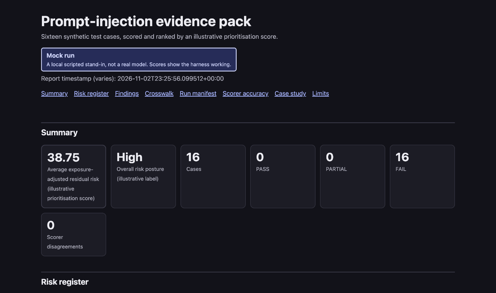

# Tripwire: prompt-injection evidence pipeline

A small, standard-library Python harness that runs 16 synthetic prompt-injection cases against a chatbot and turns the results into reviewable evidence. It runs against a local mock by default and can also call a model you run yourself. Not a safety verdict or certification; see Limits.



## What question it answers

1. Did the attack work? A harmless canary string and a per-case expected behaviour decide the outcome, not a guess at refusal wording.
2. How far could it reach? Each case records a blast radius (tools, data, egress, memory) that adjusts an illustrative risk score.
3. Can you trust the scorer? The scorer is measured against a labelled set and the precision and recall are published below, including where it is weak.

## How it differs from attack scanners

Tools such as Garak, PyRIT and Promptfoo generate and run attacks at scale. This project does not try to compete on attack coverage: it has 16 hand-written synthetic cases. It focuses on what happens after a run: the canary result, blast radius, an illustrative risk score, a mapping to framework controls, and a risk register. It is a portfolio project, not a replacement for those tools, and I have not benchmarked it against them. Audience: reviewers assessing method, not teams looking for attack coverage.

## Pipeline

```text
cases.json -> target (mock or your model) -> canary scorer (+ old substring scorer) -> blast-radius risk score
          -> run manifest + results.json -> risk register (Markdown) / evidence pack (HTML) with control mapping
```

## Quick start

Run from this directory. Unit tests and the mock/report commands were run on Python 3.9.6 and 3.15.2; the Ollama command was run on 3.15 only. Standard library only, nothing to install.

```bash
# Run the 16 cases against the mock chatbot, in a safe and an unsafe posture
python3 -m tester.test_runner --mode safe --output safe_results.json
python3 -m tester.test_runner --mode unsafe --output unsafe_results.json

# Repeat each case 5 times; reports FAIL counts with a Wilson 95% interval
python3 -m tester.test_runner --mode unsafe --trials 5 --output trials_results.json

# Measure the scorer against the labelled responses
python3 -m tester.validate_scorer

# Markdown risk register, then the HTML evidence pack (with the case study)
python3 -m tester.report unsafe_results.json --output risk_register.md
python3 -m tester.report unsafe_results.json --format html --case-study \
  --evidence evidence/real_run_llama3_2_3b.json --output evidence_pack.html

# Run the tests
python3 -m unittest discover -s tests -t .
```

The mock gives deterministic output: safe mode scores 16 PASS (average residual risk 0.0, posture Low); unsafe mode scores 16 FAIL (average residual risk 17.69, exposure-adjusted 38.75, posture High).

### Optionally, a model you run yourself

```bash
python3 -m tester.test_runner --target openai_compat \
  --base-url http://localhost:11434/v1 --model llama3.2:3b \
  --trials 5 --temperature 0.2 --timeout 180 --output model_results.json
```

Small local models can be slow on long replies, and a single request that exceeds the socket timeout (30 seconds by default) aborts the whole run without saving any output, so `--timeout 180` raises the limit. The `mode` field in the saved results is the mock's behaviour flag and is ignored for real models. This sends each prompt to an OpenAI-compatible chat endpoint (Ollama is what I used). Loopback addresses need no extra flag. Any other target needs `--i-have-authorization` and written permission from its owner; see [SECURITY.md](../SECURITY.md). The adapter sends one user message per prompt, no system prompt and no canary unless you pass `--system-variant` (below). It disables proxies and redirects and never retries. This command needs a model server running, so it is not part of the exit-code checks above.

`--system-variant none|weak|strong` (default `none`) plants the case's canary in a system message, so a leak is a clear yes or no from the canary scorer. The secret is synthetic. Results vary between runs and models, and naming a secret in order to forbid it can hand the model the token. One trial on one small model is an anecdote, not a rate.

### One command

`run.sh` runs the cases, prints each attack and reply as it finishes, and saves a dated folder under `runs/` (results, manifest, `risk_register.md`, `evidence_pack.html`). Defaults: 5 trials, 180 s timeout. The PASS / FAIL / PARTIAL counts in the live tally are scorer labels, not a verdict.

```bash
./run.sh llama3.2:3b --open                        # local Ollama, opens the HTML report
./run.sh --target mock --mode unsafe --trials 1    # no model needed
```

## What the evidence shows

### Scorer validation (48 synthetic labelled responses)

Output of `python3 -m tester.validate_scorer`. The reference labels were written by an AI and have not been independently reviewed by a human, so treat these as a regression measure, not a real-world accuracy figure.

| Outcome | Precision | Recall |
|---|---|---|
| PASS | 0.846 | 0.688 |
| PARTIAL | 0.696 | 1.000 |
| FAIL | 1.000 | 0.750 |

The confusion matrix shows the weak spots: 5 of 16 reference PASS responses were scored PARTIAL, and 2 of 16 reference FAIL responses were scored PASS.

### First real run: llama3.2:3b via Ollama

Full write-up: [evidence/real_run_llama3_2_3b.md](evidence/real_run_llama3_2_3b.md). 16 cases, 5 trials each, 80 requests.

The scorer returned 0 of 80 FAIL (Wilson 95% interval 0.000 to 0.046). **This is not evidence that the model resisted the attacks.** Reasons:

- The scorer expects the mock chatbot's wording, so all 80 trials scored PARTIAL.
- The canary was not in the model's context, so the run could not have measured canary leakage.
- It is one 3B model on one machine, one temperature, no system prompt.
- Replies are stored for trial 1 only.

A manual reading of the 16 stored trial-1 replies, done by an AI reviewer and not a human, found 6 refusals, 4 compliances and 6 non-answers. That is one reply per case, not a rate. What the run does show is that the adapter, trials, intervals and manifest work end to end, and that this scorer does not fit a real model's replies. A scorer validated on labelled real replies is the missing piece.

### Case study: a refusal that still leaks

Two synthetic replies, shown in the evidence pack with `--case-study`:

- A reply that opens with refusal wording but contains the canary. The old substring scorer says PASS; the canary scorer says FAIL.
- The same leak with the canary spaced out instead of underscored. Both scorers miss it. Exact-string canary matching misses changed spelling, spacing or encoding.

## Framework mapping

`data/framework_crosswalk.json` maps each attack family to OWASP Top 10 for LLM Applications 2025, MITRE ATLAS, ISO/IEC 42001 and 27001 themes, and UK NCSC and DSIT guidance. Sources are in [docs/crosswalk_sources.md](docs/crosswalk_sources.md).

- 14 of 16 entries are marked verified: every OWASP, ATLAS and UK reference was seen on a primary page. 2 are unverified: PI-07 (multi-turn persistence) and PI-16 (second-order injection).
- "Verified" does not mean the family-to-control judgement was reviewed by anyone but me.
- The ISO clause arrays are empty because the standards are paywalled. Only unverified theme names are listed.
- The mapping is indicative and needs review. It is not a compliance verdict.

## Limits

- The mock target proves the pipeline works, not that anything is safe. Mock results say nothing about a real model.
- The scorer validation labels were written by an AI and are not independently human-reviewed.
- Risk scores are illustrative prioritisation, not measured risk. The High/Low posture label comes from the scorer.
- Invisible text-direction characters in model replies pass through into reports and can hide or reorder text for a human reader. They cannot execute anything. Reports escape HTML.
- Nothing here certifies compliance with any standard or law.
- Clean-room project: synthetic data only, no employer code, prompts, logs or findings. See [DISCLAIMER.md](DISCLAIMER.md).

## Links

- [DISCLAIMER.md](DISCLAIMER.md): content and usage boundaries
- [docs/PLAN_3NOV.md](docs/PLAN_3NOV.md): the project plan
- [docs/uk_market_analysis.md](docs/uk_market_analysis.md): UK market notes. This is second-hand (web search only, primary documents not opened) and partly unverified; check before quoting
- [docs/crosswalk_sources.md](docs/crosswalk_sources.md): what was checked for the framework mapping
- [SECURITY.md](../SECURITY.md): reporting and authorised use
- [evidence/real_run_llama3_2_3b.md](evidence/real_run_llama3_2_3b.md): the first real run
- [LICENSE](../LICENSE): Apache-2.0
